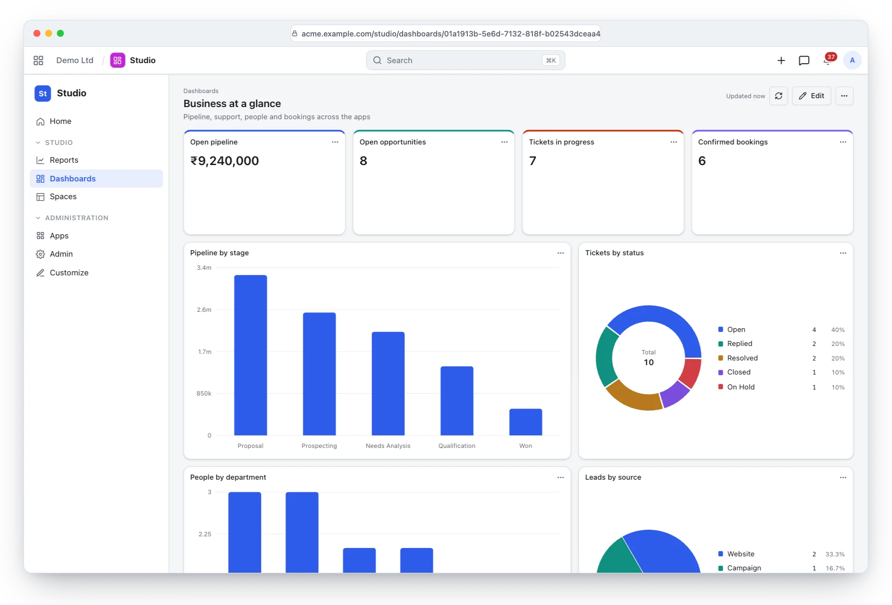
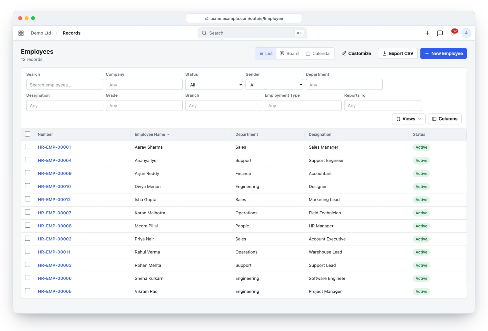
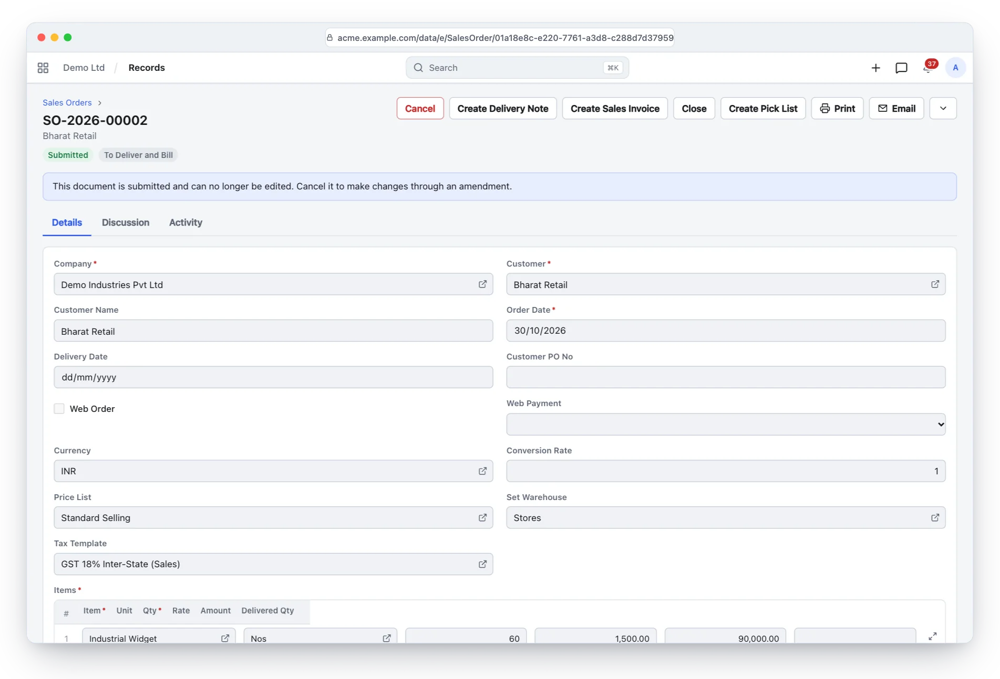
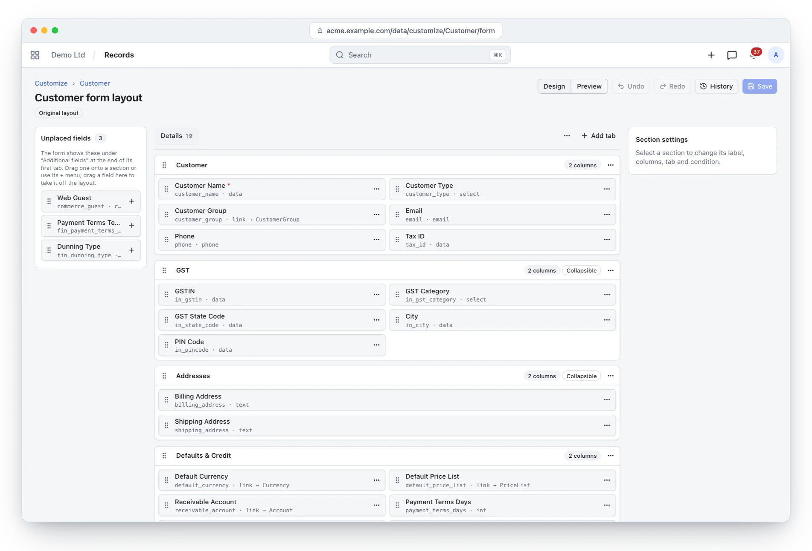
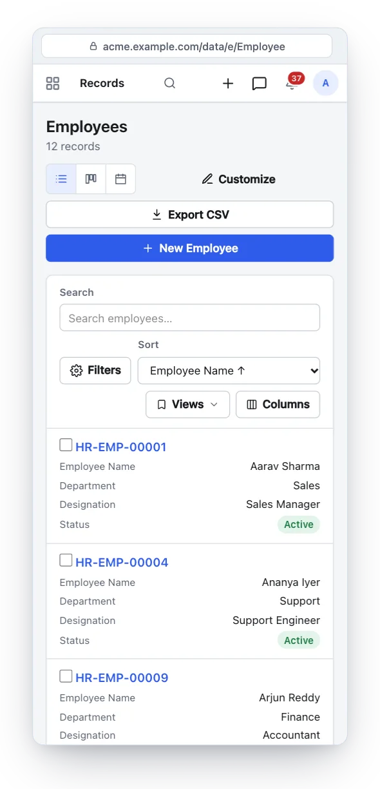
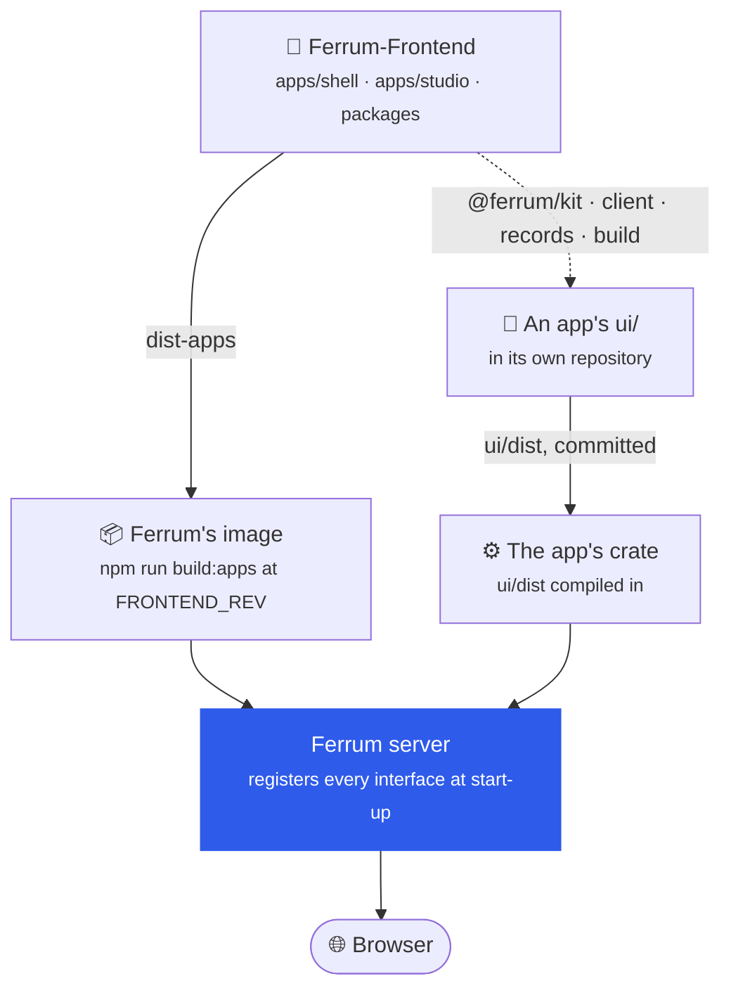
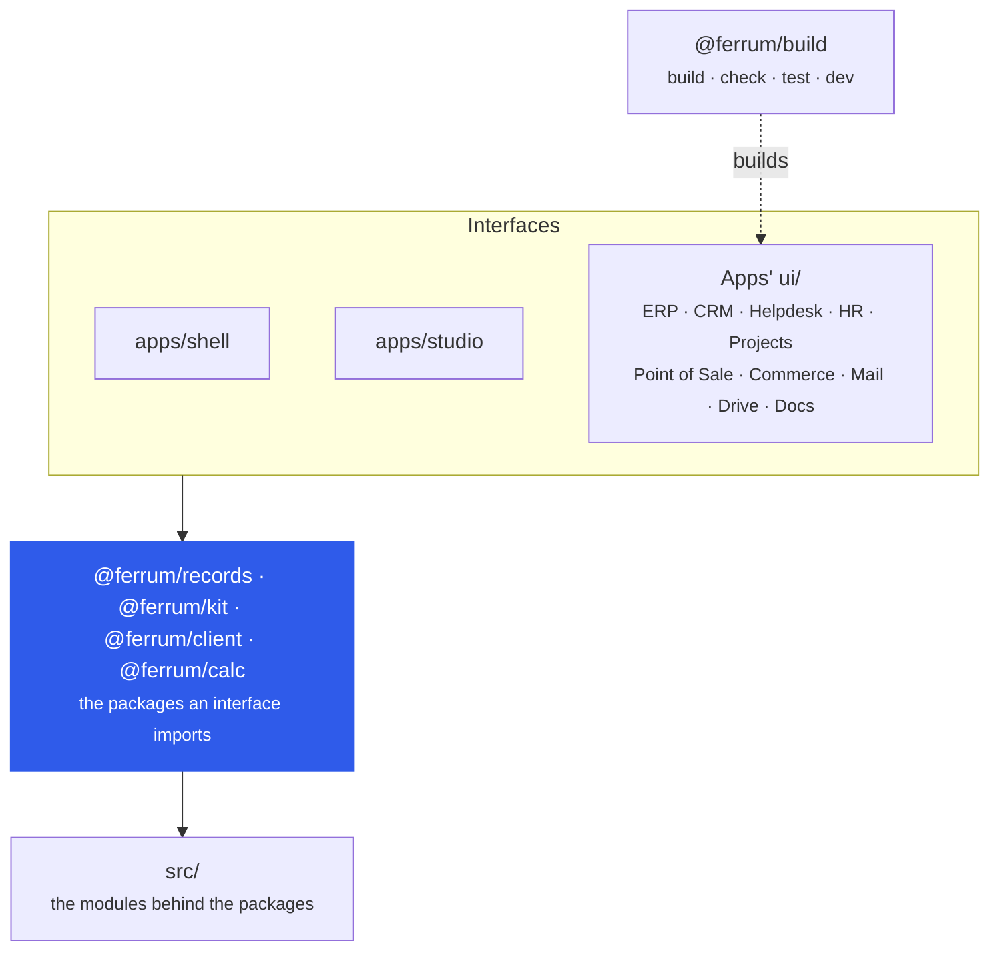

<div align="center">

<picture>
  <source media="(prefers-color-scheme: dark)" srcset="docs/assets/banner-dark.svg">
  
</picture>

[](https://github.com/CBFerrum/Ferrum-Frontend/actions/workflows/ci.yml)      

**The interfaces of [Ferrum](https://github.com/CBFerrum/Ferrum), the open-source, AI-first business platform.**<br>
Every screen is rendered from metadata: a new entity, package field or tenant custom field shows up
in lists, filters and forms without frontend changes.

[Overview](#overview) · [Screenshots](#screenshots) · [Packages](#apps-own-interfaces-and-the-packages) · [How it ships](#deploy) · [Develop](#develop) · [Phones](#phones) · [Conventions](#conventions) · [Structure](#structure)

</div>

---

## Overview

The web frontend for [Ferrum](https://github.com/CBFerrum/Ferrum), a metadata-driven ERP on Rust
and PostgreSQL. Every screen is rendered from metadata (`/api/meta`, `/api/meta/{Entity}`): a new
entity, package field or tenant custom field shows up in lists, filters and forms without frontend
changes.

| At a glance | |
|---|---|
| 🖥️ Interfaces | The shell's (`apps/shell`): Home at `/`, the store at `/store/`, administration at `/admin/`, the account at `/account/` and the records of any entity at `/data/`; and Studio's (`apps/studio`) at `/studio/` |
| 📦 Packages | `@ferrum/client`, `@ferrum/kit`, `@ferrum/records`, `@ferrum/bridge`, `@ferrum/calc`, `@ferrum/testing`, `@ferrum/build` |
| 🧩 Built with them | The interfaces of ERP, CRM, Helpdesk, HR, Projects, Point of Sale, Commerce, Mail, Drive and Docs, each in its app's repository |
| 🧱 Stack | Vite + React + TypeScript (strict), react-router, TanStack Query, Table and Virtual, Tailwind CSS with shadcn/ui on Radix, Recharts, TipTap and Yjs for documents edited together, LiveKit for meetings |
| 🚢 Ships in | Ferrum's server image, built at the commit its Dockerfile pins (`FRONTEND_REV`) |

## Screenshots

<picture>
  <source media="(prefers-color-scheme: dark)" srcset="docs/assets/studio-dashboard-dark.webp">
  
</picture>
<p align="center"><sub>Studio: a dashboard of number cards and charts over records from several apps, built without code.</sub></p>

<table>
<tr>
<td width="50%">
<picture>
  <source media="(prefers-color-scheme: dark)" srcset="docs/assets/records-list-dark.webp">
  
</picture>
<p align="center"><sub>Any entity's list, from its metadata: filters, views, columns, export.</sub></p>
</td>
<td width="50%">
<picture>
  <source media="(prefers-color-scheme: dark)" srcset="docs/assets/records-form-dark.webp">
  
</picture>
<p align="center"><sub>A submitted sales order: fields, actions and lifecycle from metadata.</sub></p>
</td>
</tr>
<tr>
<td colspan="2">
<picture>
  <source media="(prefers-color-scheme: dark)" srcset="docs/assets/form-designer-dark.webp">
  
</picture>
<p align="center"><sub>The form designer: tabs, sections and fields by drag and drop, with undo, history and a preview.</sub></p>
</td>
</tr>
</table>

> [!TIP]
> The screenshots follow your GitHub theme: switch between light and dark to see both.

## Develop

Ferrum's server answers every page: Home, the store, administration, the account and records
(`apps/shell`) and Studio (`apps/studio`), built here into `dist-apps/` and registered when the server
starts. With Ferrum's checkout beside this one (`ferrum/web` is this repository):

```sh
npm install
npm run build:apps                                              # dist-apps/shell, dist-apps/studio
cd ../server && FERRUM_UI_DIR=../web/dist-apps cargo run -- start   # http://127.0.0.1:5150/
```

Rebuild and restart the server to see a change. There is no React plugin (to keep `node_modules`
small).

## Build, check, test

| Command | What it does |
|---|---|
| `npm run typecheck` | `tsc --noEmit` (strict) |
| `npm test` | vitest: expression evaluator, API errors, decimal formatting, filters, document diff/merge, the form designer, Studio, views and more |
| `npm run build` | type-check, then `build:apps` |
| `npm run build:apps` | the shell's and Studio's interfaces into `dist-apps/`, with their release list and size budgets checked |

CI runs all of them and `npm audit`, then builds Ferrum's image from this checkout and runs Ferrum's
smoke test against it.

## Phones

<table>
<tr>
<td width="62%" valign="middle">

Every screen works on phones:

- 🗂️ Lists turn into cards with a Sort select.
- 📝 Forms keep their actions in a bar at the bottom.
- 📋 Child tables show one card per row (tap to edit).
- 🪟 Dialogs open as bottom sheets.
- 👆 Touch screens get 44px targets and 16px inputs (no zoom on iOS).
- 📱 Layouts respect the notch and home indicator.

</td>
<td width="38%" align="center">
<picture>
  <source media="(prefers-color-scheme: dark)" srcset="docs/assets/phone-list-dark.webp">
  
</picture>
</td>
</tr>
</table>

## Deploy

Nothing to deploy from here: Ferrum's server image builds the interfaces from this repository at
the commit its Dockerfile pins (`FRONTEND_REV`), or from another checkout
(`docker build --build-context frontend=<this checkout> <ferrum checkout>`). This repository's CI
does the latter and runs Ferrum's `deploy/smoke.sh` against the result.



## Apps' own interfaces and the packages

Ferrum's apps own their interfaces (docs/plan/apps-ui.md in the Ferrum repository). This repository
holds the shell's and Studio's (`apps/shell`, `apps/studio`, built into `dist-apps/` by `npm run
build:apps`), and the packages every interface uses:

| | Package | What it is |
|---|---|---|
| 🔌 | `@ferrum/client` | The bootstrap, the shell API with fallbacks, requests with the browser's session, errors, formatting, uploads |
| 🎨 | `@ferrum/kit` | The components and the look: design tokens and React components; `@ferrum/kit/primitives` for the shadcn building blocks |
| 🗃️ | `@ferrum/records` | Lists, forms, reports, people, comments and the record picker, from any entity's metadata; `@ferrum/records/frame` is the whole records frame, its routes and the modules' home |
| 🪟 | `@ferrum/bridge` | Frames, slots, intents and screens between apps and their hosts |
| 🧮 | `@ferrum/calc` | Ferrum's pricing engine in the browser: `crates/calc` built for WebAssembly, the same totals as the server |
| 🧪 | `@ferrum/testing` | A fake bootstrap and shell for apps' tests |
| 🛠️ | `@ferrum/build` | Builds, checks and tests an app's own interface (`ui/` in its repository) with this checkout's packages |



The apps keep their interfaces in their own repositories' `ui/`, built with this checkout as their
sibling (`../../ferrum/web` from their `ui/`), until the packages are published:

```
node ../../ferrum/web/packages/build/cli.mjs build      # vite build into dist/, stamped with its sources
node ../../ferrum/web/packages/build/cli.mjs check      # CI: dist/ was built from the sources as they are
node ../../ferrum/web/packages/build/cli.mjs typecheck
node ../../ferrum/web/packages/build/cli.mjs test
node ../../ferrum/web/packages/build/cli.mjs dev        # Vite behind the real bar and session (ferrum-app dev --ui)
```

`packages/build/vite.mjs` resolves an app's libraries as this repository's, so the app and the kit
share one React and one query client: this repository's dependencies (LiveKit, TipTap, Yjs among
them) are the apps' too. An app never imports this repository's own modules (`@/…`); the build
refuses it.

> [!IMPORTANT]
> An interface compiled into an app's crate is the one Ferrum serves: a copy of it in
> `FERRUM_UI_DIR` is skipped. ERP's interface moved from here to
> [ferrum-app-erp](https://github.com/CBFerrum/ferrum-app-erp), and an image built from an older
> commit of this repository still serves ERP's from its crate.

## Conventions

| | Convention |
|---|---|
| 💰 | Money and decimals are strings end to end. The UI never does arithmetic on them: totals come from `POST /api/v1/{Entity}/_calc` (debounced 400 ms while editing); display uses `Intl.NumberFormat` on the decimal string (exact rounding) with the record currency's precision when known. |
| ✅ | Conditions the evaluator cannot parse (function calls, arithmetic…) resolve permissively (field shown, action offered); the server is the authority and its 422 errors are shown inline, including child-row errors (`row: [table, index]`). |
| 🔒 | Saves send `If-Match: "v<version>"`; a 409 offers a reload. Creates send an `Idempotency-Key`, so the client may safely retry them on connection errors. |
| 🖨️ | Print HTML is opened from a blob URL with a script-blocking CSP injected (print templates are tenant-editable). |

| Keys | Where | What |
|---|---|---|
| <kbd>/</kbd> | any page | search |
| <kbd>Ctrl</kbd>/<kbd>⌘</kbd> + <kbd>K</kbd> | any page | command palette |
| <kbd>Ctrl</kbd>/<kbd>⌘</kbd> + <kbd>S</kbd> | a form | save |
| <kbd>Alt</kbd> + <kbd>↑</kbd>/<kbd>↓</kbd> | a child table | move a row |
| <kbd>Ctrl</kbd> + <kbd>Enter</kbd> | a child table | insert a row below |

## Structure

```
apps/
  shell/              the shell's own interface: Home (/), the store (/store/), administration
                      (/admin/), the account (/account/) and the records of any entity (/data/)
  studio/             Studio (/studio/): reports, charts, number cards, dashboards and spaces
packages/             the entry points interfaces import: client, kit, records, bridge, calc, testing,
                      build (their modules mostly still live in src/ and move in over time)
scripts/              releases.mjs (dist-apps/index.json for the server), budgets.mjs (size budgets)
src/
  index.css           Tailwind and the design tokens (light/dark, contrast, density)
  styles.css          layout and components
  components/ui/      the shadcn building blocks, exported as @ferrum/kit/primitives
  ui/kit.tsx          the design system's small, accessible building blocks
  lib/
    api.ts            HTTP client: bearer auth, uniform error parsing, retries on connection
                      errors, authenticated downloads, print via blob URL
    meta.ts           metadata types and hooks, field state (visible / required / read-only)
    expr.ts           evaluator for the common CEL subset used by visible_if / required_if /
                      read_only_if and action/workflow conditions
    format.ts         exact decimal formatting/comparison (money stays a string), dates
    filters.ts        list filter state ⇄ URL ⇄ API `filters` JSON
    doc.ts            create/patch bodies, merging `_calc` previews into the edited document
    formLayout.ts     the form designer's model; formTabs.ts the form's tabs and sections
    views.ts          board, calendar and timeline views
    studio.ts         Studio's API and its saved records
    live.ts           live updates (/ws/live), one socket per tab
    files.ts          uploads, through the API or straight to object storage
    prefs.ts          per-user preferences; theme.ts theme, contrast and density
    screens.ts        apps' screens: pages, dashboard widgets, form panels
    pwa.ts            install prompt, online state, a newer version deployed
    *.test.ts         unit tests
  app/
    Shell.tsx         auth guard, sidebar from metadata modules, top bar, keyboard shortcuts
    Home.tsx          the modules' quick links and recent documents
    ListView.tsx      /e/:entity: columns, filters, search, sort, saved views, bulk actions, CSV export
    Views.tsx         board, calendar and timeline views of any entity
    FormView.tsx      /e/:entity/:id: tabs and sections, live totals, save/If-Match, 409/422 handling,
                      submit/cancel/amend/delete, custom actions, workflow, print, email, audit trail
    widgets.tsx       field widgets, link autocomplete, child-table grid (cards on phones), attachments
    Collab.tsx        discussion on any record: assignees, tags, following, attachments, comments
    ReportView.tsx    /r/:name: parameter form, tree/bold rows, totals, CSV download
    Customize.tsx     /customize/:entity: fields, custom fields, properties, rules, change sets
    FormDesigner.tsx  /customize/:entity/form: tabs, sections and fields by drag and drop (designer/)
    Admin.tsx         users, roles, packages, webhooks, automations, plugins, API keys, single sign-on
    Apps.tsx          installed apps, the store and uploads
    Screen.tsx        apps' screens in sandboxed frames
    studio/           Studio's builders: reports, charts, number cards, dashboards, spaces
    recordsRoutes.tsx the records frame's routes (@ferrum/records/frame)
    records.css       phone layouts of lists, forms and child tables
```

## License

[AGPL-3.0-or-later](LICENSE), like the platform. Part of [Ferrum](https://github.com/CBFerrum/Ferrum) ·
[Report an issue](https://github.com/CBFerrum/Ferrum-Frontend/issues)
